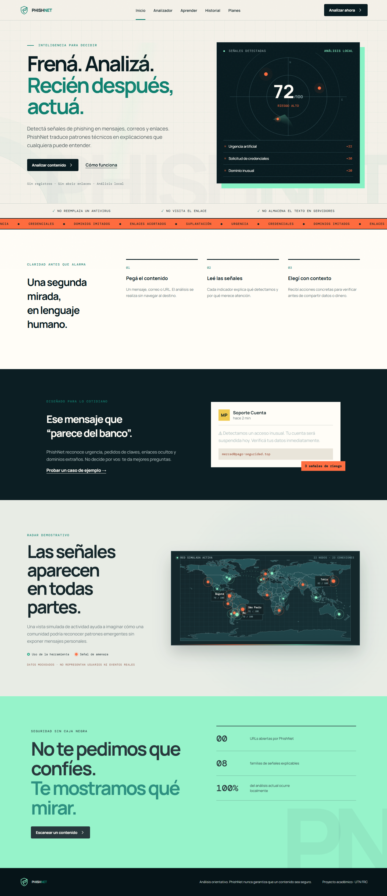

# PhishNet

PhishNet es un prototipo académico que ayuda a reconocer posibles estafas digitales. Analiza mensajes, correos y URLs con reglas explícitas y devuelve un nivel de riesgo **orientativo**, indicadores comprensibles y acciones preventivas.

> Un resultado bajo nunca garantiza que un enlace o mensaje sea seguro. La demo no navega a URLs ingresadas ni consulta servicios externos.

## Problema y propuesta de valor

Muchas personas reciben mensajes fraudulentos, pero las herramientas existentes suelen ofrecer veredictos técnicos o centrarse solo en archivos y URLs. PhishNet integra texto y enlaces, explica el porqué y adapta los ejemplos a fraudes frecuentes en Argentina.

## Funcionalidades verificables

- Validación de longitud y formato de entrada.
- Detección de urgencia, solicitudes de credenciales, disparadores económicos, acortadores, TLD inusuales, HTTP, IPs y subdominios extensos.
- Puntaje y clasificación bajo/medio/alto con explicación trazable.
- Recomendaciones según riesgo; nunca declara contenido “seguro”.
- Casos de demostración explícitos, historial local y contenido educativo.
- Pantallas de planes y dashboard B2B rotuladas como hipótesis/prototipo.
- Responsive, navegación por teclado, foco visible, reducción de movimiento y contraste AA en las combinaciones principales.

## Stack y arquitectura

React + TypeScript + Vite. El motor heurístico es una función pura en `app/analyzer.ts`; no hay backend ni persistencia remota. El historial usa `localStorage` y evita almacenar más que una vista previa limitada.

```text
UI React → validación → motor heurístico local → resultado explicable
                                      └──────→ historial local opcional
```

## Capturas verificadas



La versión móvil verificada está en [`design/screenshots/landing-mobile.png`](design/screenshots/landing-mobile.png).

## Ejecutar

Requiere Node.js 22 o compatible.

```bash
npm install
npm run dev
```

Pruebas y build:

```bash
npm test
npm run build
```

No se requieren variables de entorno. `.env.example` documenta la futura integración de reputación; nunca commitear claves.

## Documentación

- [Auditoría y matriz de requisitos](docs/auditoria-consignas.md)
- [Sprint 1 y contenido para Mural](docs/sprint-1.md)
- [Business Model Canvas](docs/business-model-canvas.md)
- [Value Proposition Canvas](docs/value-proposition-canvas.md)
- [Validación del problema](docs/validacion-problema.md)
- [Arquitectura y seguridad](docs/arquitectura.md)
- [Identidad visual](docs/identidad-visual.md)
- [Pendientes reales](docs/pendientes.md)

## Limitaciones

- No usa Google Safe Browsing, VirusTotal ni IA externa; cualquier integración requiere credenciales y evaluación de privacidad.
- No analiza adjuntos, reputación histórica, DNS ni contenido de una página.
- Las cifras del dashboard y los planes pagos son demostrativos, no resultados comerciales.
- No existen entrevistas, usuarios activos, acuerdos ni métricas observadas a la fecha.

## Roadmap

1. Validar problema con 15 entrevistas y pruebas moderadas.
2. Integrar una fuente de reputación con minimización de datos y proxy seguro.
3. Separar parser de correo, mejorar detección de Unicode y agregar internacionalización.
4. Evaluar modelo B2B con PyMEs sin almacenar contenido sensible.

Proyecto para Emprendimientos Tecnológicos — Ingeniería en Sistemas de Información, UTN FRC.
